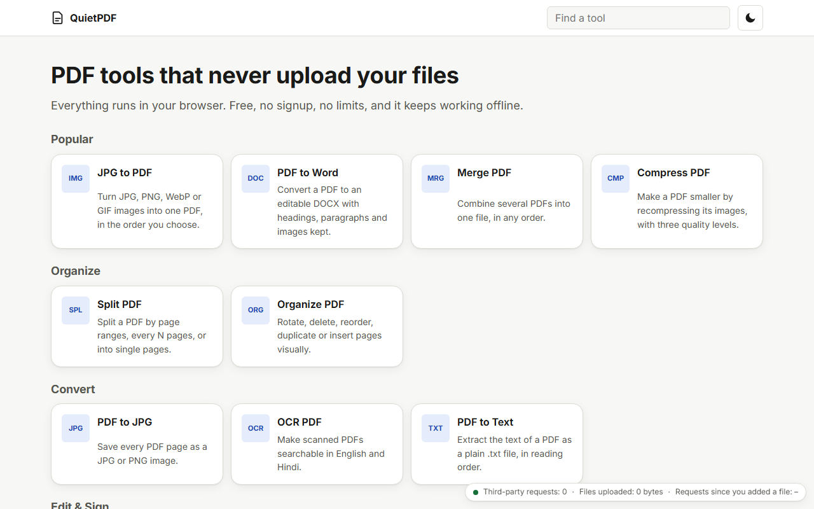
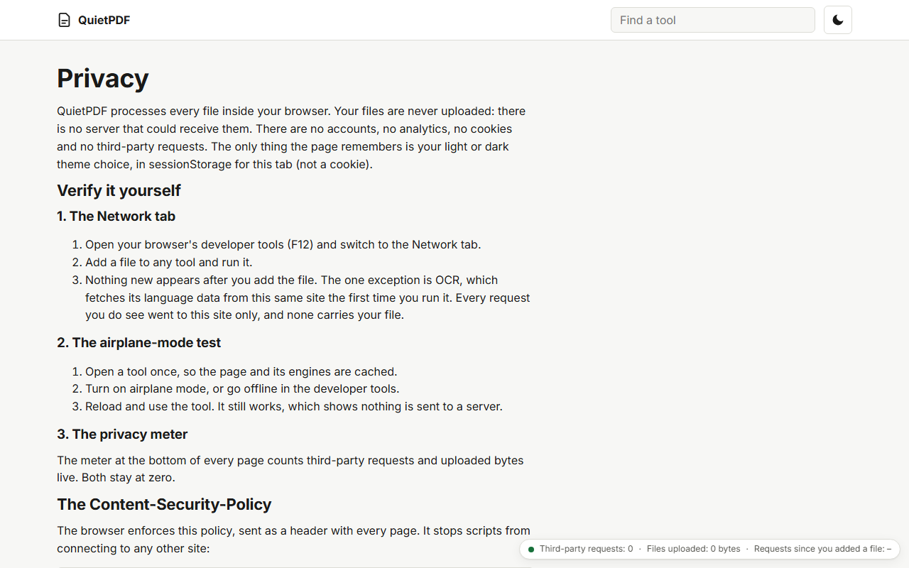
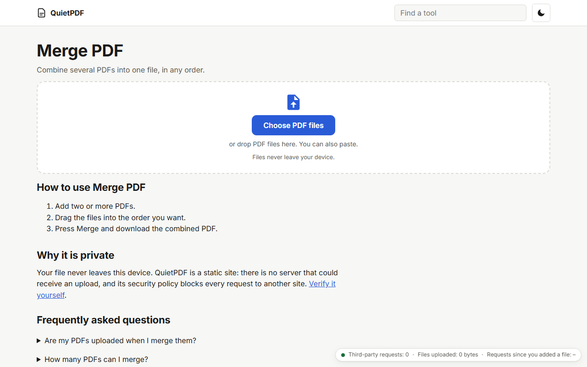

# QuietPDF


Live: https://quietpdf-279.pages.dev
Free PDF tools that run entirely in your browser. Your files never leave your device: nothing is uploaded, no accounts, no ads, no analytics and no cookies.



## The privacy proof

You do not have to take our word for it.

- A strict Content-Security-Policy (`connect-src 'self'`, `script-src 'self'`) forbids requests to any other origin.
- Every engine (pdf.js, qpdf, Tesseract) and every font is self-hosted. Nothing loads from a CDN.
- The privacy meter at the bottom of every page counts third-party requests and uploaded bytes live. Both stay at zero.
- Open DevTools, then Network, add a file and watch: no request leaves this site and none carries your file. OCR fetches its language data from this site on first use.
- `npm run check:third-party` scans the built site for any off-origin reference.
- The app works offline after the first visit (PWA).



## Tools

Merge, split, compress, organize (rotate, reorder, delete, extract), JPG to PDF, PDF to JPG, sign, page numbers, watermark, protect, unlock, true redaction, OCR (English and Hindi), PDF to Word and PDF to text.



## Local development

```
npm install
npm run dev            # dev server
npm run build          # copies vendor files, writes third-party notices, builds dist/
npm run preview        # serves dist/ locally
npm run test:unit      # vitest
npm run test:e2e       # playwright
npm run check:assets
npm run check:third-party
```

## Third-party software

Notices for every shipped dependency, font and model are in `public/third-party-licenses.txt` (generated by `scripts/gen-notices.ts`, served at `/third-party-licenses.txt`).

## Licence

© Arpan Mandal. All Rights Reserved.

See the `COPYRIGHT` file. There is no open-source licence.
